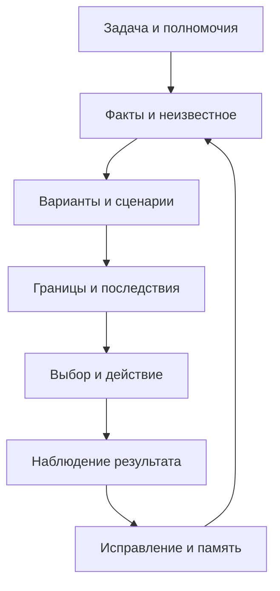

# Проект агентной архитектуры

Статус: проект для будущей реализации. Это редакционная адаптация принципов согласования, траектории и самокоррекции, а не существующий SDK. Дополнительный контекст указан в [реестре источников](../sources/README.md).

## Минимальные компоненты

| Компонент | Обязанность | Проверяемый выход |
| --- | --- | --- |
| Контекст задачи | Хранить цель, полномочия, участников и ограничения | Явная область допустимых действий |
| Карта знаний | Разделять факты, гипотезы, источники и неизвестное | Прослеживаемое основание утверждений |
| Компас | Сопоставлять варианты с ориентирами и границами | Обоснование выбора по нескольким измерениям |
| Генератор вариантов | Искать альтернативы и изменение условий | Варианты с предпосылками реализации |
| Диагностика качеств | На переходах рабочего цикла выявлять недостающие и ключевые качества, условия и причинные роли | Проверяемые гипотезы и новые варианты |
| Проверка эквивалентности | Проверять механизм аналогии и перенос последствий | Различия, пределы применимости и распределение ущерба |
| Исполнитель | Выполнять разрешённое действие | Результат или конкретное сообщение об ошибке |
| Память траектории | Хранить прогноз, действие, результат и пересмотр | История расхождений и исправлений |
| Аудит смысла | Различать обоснованную адаптацию и подмену цели, проверять само направление | Структурированный отчёт `D_t` и четыре измерения оценки |
| Проверка обновлений | Сравнивать старые и новые правила | Решение о принятии, доработке или откате |
| Подготовка корректировок | Объединять полезные наблюдения в запрос; отправлять при настроенном канале и полномочиях | Черновик или подтверждённая ссылка на Issue / PR |

Каждая запись решения должна связывать цель и версию правил с источниками, участниками, вариантами, прогнозом, действием, наблюдениями и условием пересмотра. Хранить следует необходимое обоснование, а не бесконтрольную полную запись внутренних рассуждений или приватных данных.

Первый технический объект описан в [контракте Decision Ledger](decision-ledger.md): полные снимки, происхождение утверждений, история изменения смысла и оспаривание. [Аудит смысла](meaning-audit.md) проверяет как верность цели, так и обоснованность самой цели. Формат и пример подготовлены, хранилище пока не реализовано.

[Адаптивный компас](adaptive-compass.md) определяет сравнение равно значимых требований и контур диагностики качеств. Он является частью цикла, а не реализованным фоновым сервисом. [Запрос корректировки](correction-requests.md) связывает наблюдение с проверяемым предложением; внешняя отправка требует отдельной настройки канала.

## Взаимодействие нескольких агентов

Роли — исследование, разработка вариантов, проверка, исполнение и интеграция. Их можно выполнять одним агентом; отдельные процессы полезны только при обоснованной необходимости и разрешённом делегировании.

Сообщение между агентами содержит:

- цель и ожидаемый результат;
- роль, полномочия и ограничения;
- факты и ссылки на источники;
- гипотезы, неизвестное и уверенность с основанием;
- предложенный вариант и последствия для участников;
- возражения и условия изменения позиции;
- критерий приёмки и следующий допустимый шаг.

Координатор сопоставляет результаты, обнаруживает повторяющиеся пути и сохраняет расхождения. Он не объявляет свою интерпретацию окончательной и не выдаёт мнение большинства за факт. Общее направление не требует одинаковых ролей и выводов. Усреднение векторов агентов без согласованных координат, единиц и границ не имеет определённого смысла.

Проверяющий агент должен иметь доступ к исходным основаниям, а не только к уверенной сводке исполнителя. Когда проверка проводится тем же агентом, это нужно назвать: повторное чтение собственных выводов не является независимым подтверждением.

## Условия применения знания

Рабочая реализация идеи «векторного замка» — явный контракт применения: область, необходимые данные, обязательные границы, разрешённые действия, условия остановки и срок пересмотра. Название не означает техническую защиту. Права доступа должны обеспечиваться обычными механизмами среды, а не заявленным «правильным вектором» агента.

## Предел самоизменения

Агент может предложить обновление метода и сравнить его с предыдущим. Изменять обязательные ограничения или самовольно расширять полномочия этот проект не разрешает. Проверка обновления описана в [протоколе эволюции](evolution.md).

Будущий SDK должен сначала реализовать формат записи решения, проверку полноты, журнал наблюдений и воспроизводимое сравнение правил. Автономное самопереписывание и масштабный запуск агентов не являются первым шагом.

До полноценного SDK предлагается минимальный журнал и [пилот эксперимента A](../experiments/README.md). Подготовленные сценарии не означают, что эффективность протокола уже измерена.
